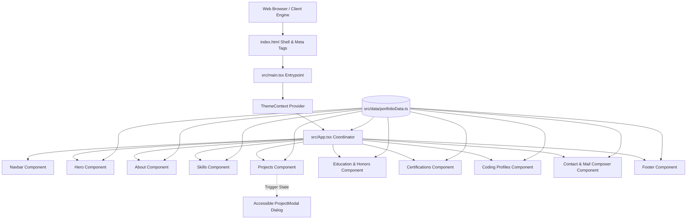
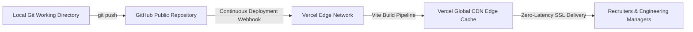

# Architecture & System Design — Lavansh Jindal Portfolio

This document outlines the architectural blueprints, component hierarchies, state management patterns, and design patterns utilized in the portfolio application.

---

## 1. High-Level System Architecture

The application is structured as a **Single-Page Application (SPA)** rendered statically on the client using modern React 19 and compiled via Vite 8.



---

## 2. Component Hierarchy & Data Flow

```text
App (Root Coordinator)
 ├── ThemeProvider (Dark / Light Context)
 ├── Navbar (Sticky Glass Navigation)
 │    ├── Brand Logo (LJ Monogram)
 │    ├── Nav Links (Home, About, Skills, Projects, Education, Contact)
 │    ├── Social Icons (GitHub, LinkedIn, LeetCode)
 │    ├── Theme Toggle (Sun / Moon)
 │    ├── Resume Download Button
 │    └── Mobile Drawer (Conditional Menu)
 ├── Main (Semantic Container)
 │    ├── Hero (First Impression & Identity)
 │    │    ├── Availability Badge
 │    │    ├── Headline & Dual-Role Typewriter Cycler
 │    │    ├── Supporting Bio
 │    │    ├── Institution & CGPA Badges
 │    │    ├── CTAs (Projects, Resume, Contact)
 │    │    └── Profile Image Glowing Ring
 │    ├── About (Background & Academic Pillars)
 │    │    ├── Quick Stats Metrics Grid (CGPA, Dean's List, Projects, Certs)
 │    │    ├── Engineering Philosophy Card
 │    │    └── Core Capability Pillars
 │    ├── Skills (Verified Tooling)
 │    │    ├── Category Filter Pills
 │    │    └── 4 Distinct Category Cards with Verified Badges
 │    ├── Projects (Featured Production Implementations)
 │    │    ├── Project Card 1: RoleReady AI (Full-Stack / GenAI)
 │    │    ├── Project Card 2: Customer Shopping Behavior Analysis (Analytics / BI)
 │    │    └── ProjectModal (Accessible Dialog with Tabs: Overview, Architecture, Tech, Challenges)
 │    ├── Education (Academic Qualifications & Honors)
 │    │    ├── Timeline: Bennett University, Class XII, Class X
 │    │    └── Scholastic Honors Card (Dean's List 2023)
 │    ├── Certifications (5 Verified Credentials)
 │    ├── CodingProfiles (GitHub, LeetCode, LinkedIn Cards)
 │    └── Contact (Interaction & Inquiries)
 │         ├── Direct Contact Cards (Email & Phone with Copy Actions)
 │         └── Interactive Free Mailto Composer
 └── Footer (Quick Links, Copyright & Back-to-Top)
```

---

## 3. Data Architecture & Separation of Concerns

All business and profile data is strictly separated from the presentation layer:
- **`src/types/portfolio.ts`**: Declares rigid TypeScript interfaces (`PersonalInfo`, `ProjectDetail`, `SkillCategory`, `EducationItem`, `AchievementItem`, `CertificationItem`, `CodingProfile`).
- **`src/data/portfolioData.ts`**: Serves as the single source of truth containing verified facts matching Lavansh Jindal's resume. Modifying a link, phone number, or project description requires updating this single file.

---

## 4. Navigation & Scroll Spy Architecture

Instead of introducing heavyweight client-side routing libraries like `react-router-dom` for a portfolio site, this project employs an **anchor-based single-page navigation system** combined with an efficient **Scroll Spy**:
1. Sections are addressed via semantic HTML IDs (`#hero`, `#about`, `#skills`, `#projects`, `#education`, `#certifications`, `#profiles`, `#contact`).
2. `App.tsx` listens to the window scroll event with passive listeners (`{ passive: true }`).
3. As the user scrolls, `offsetTop` coordinates are evaluated to compute `activeSection`.
4. `Navbar` receives `activeSection` and applies visual accent styles to indicate the user's current reading position.
5. Smooth scrolling is native and accelerated via CSS (`html { scroll-behavior: smooth; }`).

---

## 5. Modal & Accessibility Architecture

In conformance with **Modern Web Guidance**:
- The project modal utilizes the native HTML5 `<dialog>` element.
- Opened programmatically via `dialogRef.current.showModal()`, granting browser-native focus trapping and top-layer positioning.
- Dismissed gracefully using the native `Esc` key (`onCancel` synthetic event) or clicking on the backdrop.
- Scroll containment is configured in `src/index.css`:
  ```css
  dialog:modal {
    overscroll-behavior: contain;
  }
  dialog::backdrop {
    overflow: hidden;
    overscroll-behavior: contain;
  }
  ```
  This prevents background page scrolling while the case study modal is inspected.

---

## 6. Theme Architecture (Dark / Light Mode)

1. **State Management**: `ThemeContext.tsx` handles `'dark' | 'light'` state, defaulting to `'dark'`.
2. **Persistence**: Saved automatically in `localStorage.getItem('lavansh_portfolio_theme')`.
3. **DOM Sync**: Toggles the `.dark` class directly on `document.documentElement` (`<html>`).
4. **CSS Variants**: Tailwind CSS v4 custom variant:
   ```css
   @custom-variant dark (&:where(.dark, .dark *));
   ```
   Ensures instant re-rendering without flash of unstyled content (FOUC).

---

## 7. Zero-Cost Infrastructure & Deployment Architecture



- **Hosting**: Vercel Hobby Plan (100% Free).
- **Domain**: Automated free SSL on `*.vercel.app` or GitHub Pages.
- **Assets**: All images (`profile.jpg`) and documents (`resume.pdf`) are served locally from `public/` as immutable static assets, requiring zero third-party cloud storage fees.
