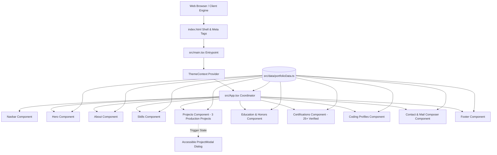

# Architecture & System Design — Lavansh Jindal Portfolio

This document outlines the architectural blueprints, component hierarchies, state management patterns, and design patterns utilized in the portfolio application.

---

## 1. High-Level System Architecture

The application is structured as a **Single-Page Application (SPA)** rendered statically on the client using modern React 19 and compiled via Vite 8.



---

## 2. Component Hierarchy & Data Flow

```text
App (Root Coordinator)
 ├── ThemeProvider (Dark / Light Context)
 ├── Navbar (Sticky Glass Navigation)
 │    ├── Brand Logo (LJ Monogram)
 │    ├── Nav Links (Home, About, Skills, Projects, Education, Certifications, Contact)
 │    ├── Social Icons (GitHub, LinkedIn, LeetCode)
 │    ├── Theme Toggle (Sun / Moon)
 │    ├── Resume Download Button
 │    └── Mobile Drawer (Conditional Menu)
 ├── Main (Semantic Container)
 │    ├── Hero (First Impression & Identity)
 │    │    ├── Availability Badge
 │    │    ├── Headline & Multi-Role Typewriter Cycler
 │    │    ├── Supporting Bio
 │    │    ├── Institution & CGPA Badges
 │    │    ├── CTAs (Projects, Resume, Contact)
 │    │    └── Profile Image Glowing Ring
 │    ├── About (Background & Academic Pillars)
 │    │    ├── Quick Stats Metrics Grid (CGPA, Dean's List, 3 Projects, 25+ Certs)
 │    │    ├── Engineering Philosophy Card
 │    │    └── Core Capability Pillars (Data Warehousing, Full-Stack, BI Analytics)
 │    ├── Skills (Verified Tooling)
 │    │    ├── Category Filter Pills
 │    │    └── 4 Distinct Category Cards with Verified Badges
 │    ├── Projects (Featured Production Implementations)
 │    │    ├── Project Card 1: Enterprise SQL Data Warehouse & ETL Pipeline
 │    │    ├── Project Card 2: RoleReady AI (Full-Stack / GenAI)
 │    │    ├── Project Card 3: Customer Shopping Behavior Analysis (Analytics / BI)
 │    │    └── ProjectModal (Accessible Dialog with Tabs: Overview, Architecture, Tech, Challenges)
 │    ├── Education (Academic Qualifications & Honors)
 │    │    ├── Timeline: Bennett University, Class XII, Class X
 │    │    └── Scholastic Honors Card (Dean's List 2023)
 │    ├── Certifications (25+ Verified Credentials across 5 Domain Categories)
 │    ├── CodingProfiles (GitHub, LeetCode, LinkedIn Cards)
 │    └── Contact (Interaction & Inquiries)
 │         ├── Direct Contact Cards (Email & Phone with Copy Actions)
 │         └── Interactive Free Mailto Composer
 └── Footer (Quick Links, Copyright & Back-to-Top)
```

---

## 3. Data Architecture & Separation of Concerns

All business and profile data is strictly separated from the presentation layer:
- **`src/types/portfolio.ts`**: Declares rigid TypeScript interfaces (`PersonalInfo`, `ProjectDetail`, `SkillCategory`, `EducationItem`, `AchievementItem`, `CertificationItem`, `CodingProfile`).
- **`src/data/portfolioData.ts`**: Serves as the single source of truth containing verified facts.

---

## 4. Modal & Accessibility Architecture

In conformance with **Modern Web Guidance**:
- The project modal utilizes the native HTML5 `<dialog>` element.
- Opened programmatically via `dialogRef.current.showModal()`, granting browser-native focus trapping and top-layer positioning.
- Dismissed gracefully using the native `Esc` key (`onCancel` synthetic event) or clicking on the backdrop.
- Scroll containment is configured in `src/index.css`:
  ```css
  dialog:modal {
    overscroll-behavior: contain;
  }
  dialog::backdrop {
    overflow: hidden;
    overscroll-behavior: contain;
  }
  ```
